# EarForge

English | [中文](README.md)

**Learn to hear notes in music: free, open-source, offline-ready ear training with movable do, right in your browser.**

<!-- TODO: replace the link below with your GitHub Pages URL after deploying -->
**[▶ Try it online](https://<your-username>.github.io/earforge/)** (TODO: replace with the real URL) · [Changelog](CHANGELOG.md) · [Contributing](CONTRIBUTING.md)

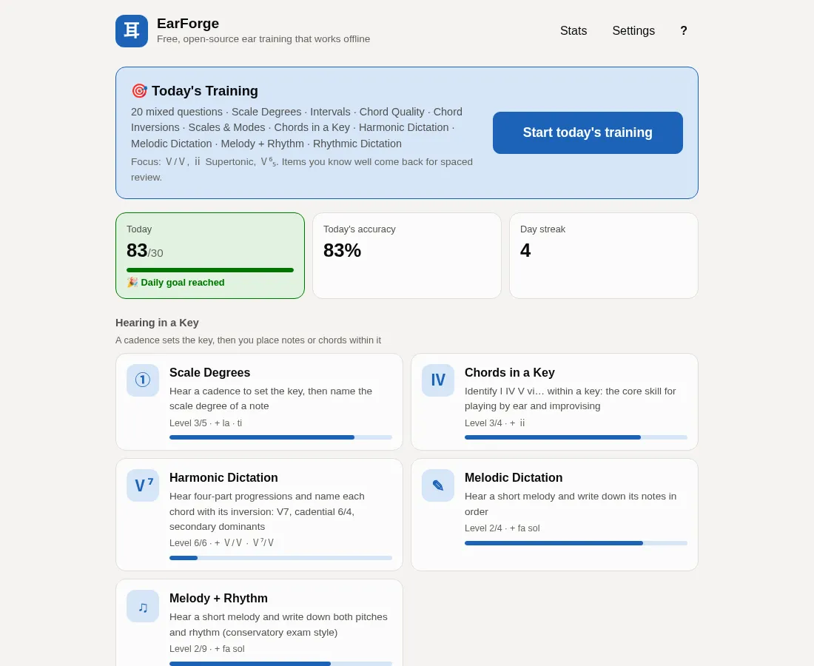

<table>
  <tr>
    <td width="50%">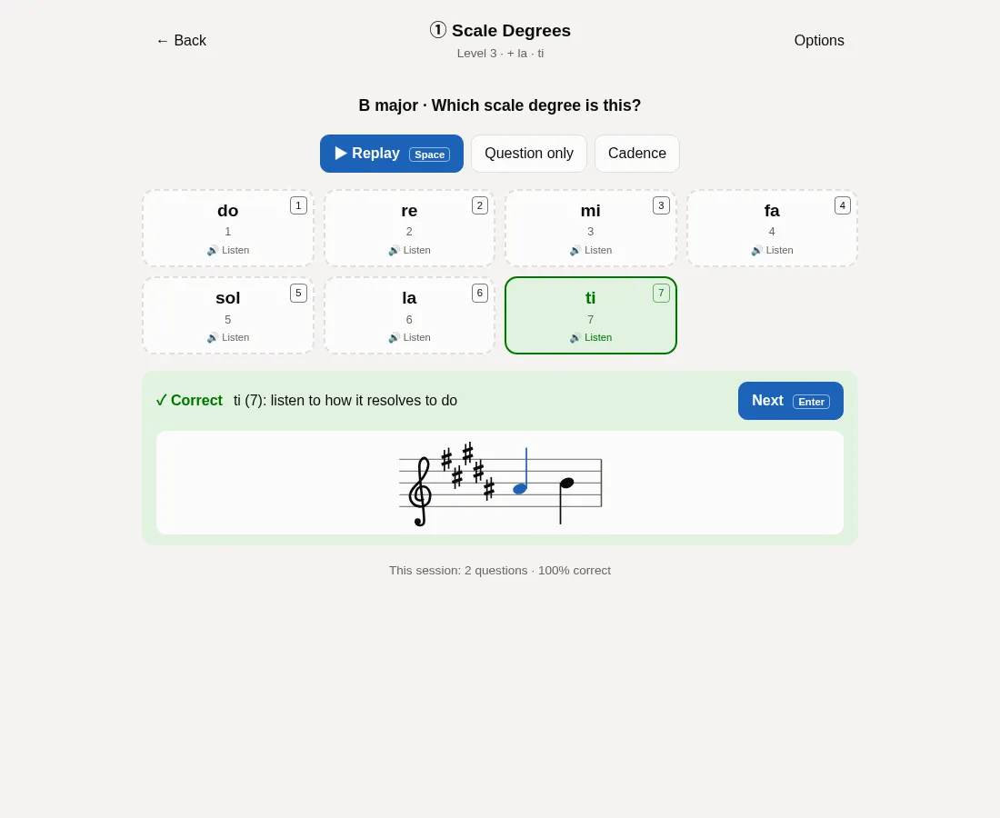</td>
    <td width="50%">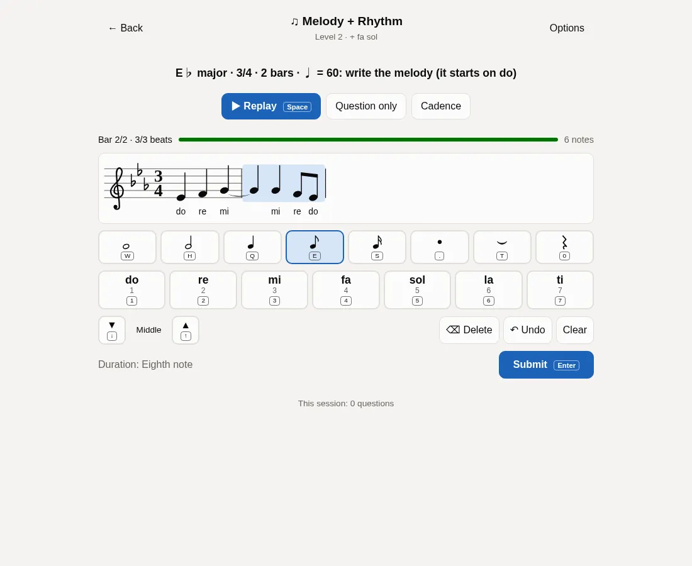</td>
  </tr>
  <tr>
    <td>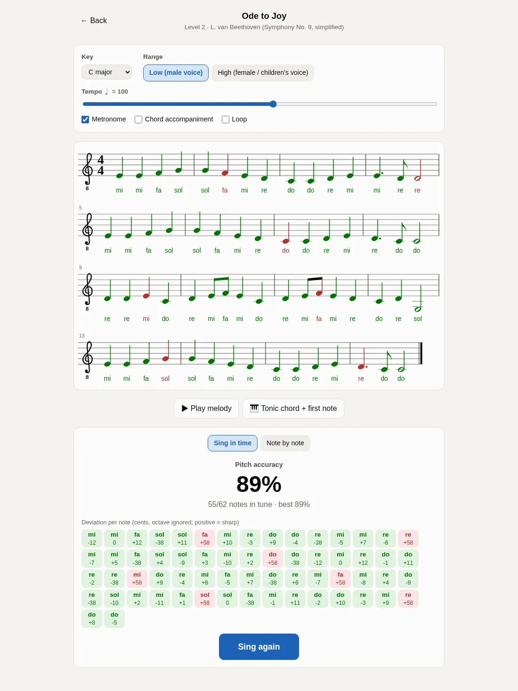</td>
    <td>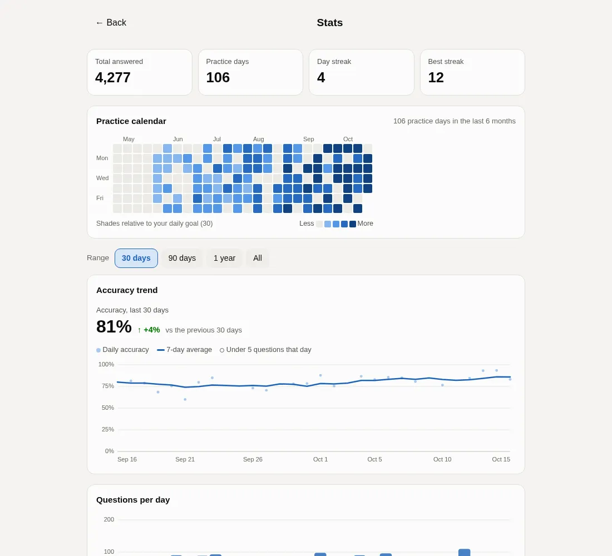</td>
  </tr>
</table>

## Why EarForge

- **Functional ear training**: every question first sets the key with a cadence, then asks you to hear what a note or chord *does* in that key. After you answer, you hear it resolve to do. You learn to hear notes in real music, not just isolated intervals.
- **Movable do**: do is always the tonic, so the syllables stay the same in every key. This is the relative pitch you use to play by ear, sight-sing and improvise. You can also switch to scale-degree numbers, fixed do or letter names.
- **Adaptive, with a plan**: spaced repetition builds "Today's Training". Weak items come up more often, levels unlock as you master them, and the Stats page drills your weak spots with one click.
- **Free, open source, no sign-up**: MIT-licensed, with no accounts, ads or analytics. Your data stays in your browser.
- **Works offline**: it is a PWA you can install on desktop or phone, and after the first visit you can practise without a connection.

Compared with popular paid ear-training apps such as EarMaster or Tenuto: those apps offer mature curricula, more question types and features for teachers and schools, and are well worth a look. EarForge has a different focus. It is a free, open-source web app that runs from a URL, with nothing to install and no account to create, a Chinese-first bilingual interface, and a design built around movable do and hearing in a key.

| | EarForge | Typical paid ear-training apps |
|---|---|---|
| Price | Free | One-time purchase or subscription |
| Account | Not needed | Depends on the product |
| Platforms | Any modern browser (desktop and mobile), installable as a PWA | Desktop or app-store apps |
| Offline | Yes | Depends on the product |
| Source code | Open (MIT) | Closed |
| Data | Stays in your browser; exportable | Depends on the product; some sync to the cloud |

## Features

### Daily practice
- **Today's Training**: one tap starts a mixed set (20 questions by default). Spaced repetition picks the items you most need across exercises, and you get a summary at the end.
- **Adaptive practice**: mastery is tracked per item. Weak items come up more often, older ones come back for review, and the next level unlocks once you have mastered the current one.
- **Compare when wrong**: a wrong answer plays what you chose. After answering, every option can be auditioned, and you can switch between "your answer" and "correct answer" with one click.
- **Daily goal and streaks** on the home page.
- **Guided start**: a short first-run setup picks starting levels from your background (beginner, instrumentalist, exam prep), and each exercise shows a quick how-to the first time.

### Exam prep
- **Mock exams**: three papers (quick check, graded exam, conservatory entrance). There is no feedback while you answer, with optional time and replay limits. Afterwards you get a report with section scores, weak items and a question-by-question review where you can replay and compare. Past results are kept.
- **Melody + rhythm dictation**: a conservatory-style task. Write pitches and durations in a staff editor with the keyboard, on-screen buttons or a MIDI keyboard. Pitch and rhythm are graded separately.
- **Harmonic dictation**: hear a four-part progression (4 or 6 chords) and name each chord with its inversion, from I IV V up through first inversions, V7 and its inversions, the cadential 6/4, ii7, vii°6 and the secondary dominant V/V, in major and minor. Progressions follow functional-harmony rules with smooth voice leading and no parallel fifths or octaves. Options are grouped by function (tonic / predominant / dominant / secondary dominants), and a grand staff appears after you answer. The graded and conservatory mock exams include a harmonic dictation section.
- **Staff notation**: correct key signatures and accidentals, with full rhythmic notation (time signatures, beams, dots, ties, triplets, automatic line breaks).

<table>
  <tr>
    <td width="50%">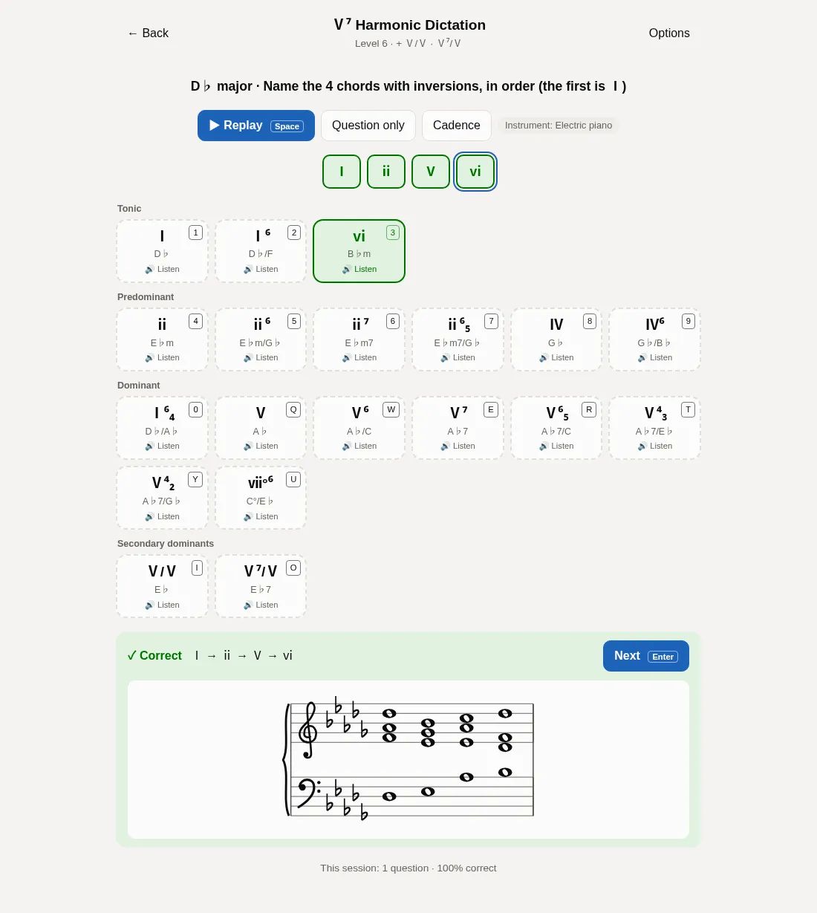</td>
    <td width="50%">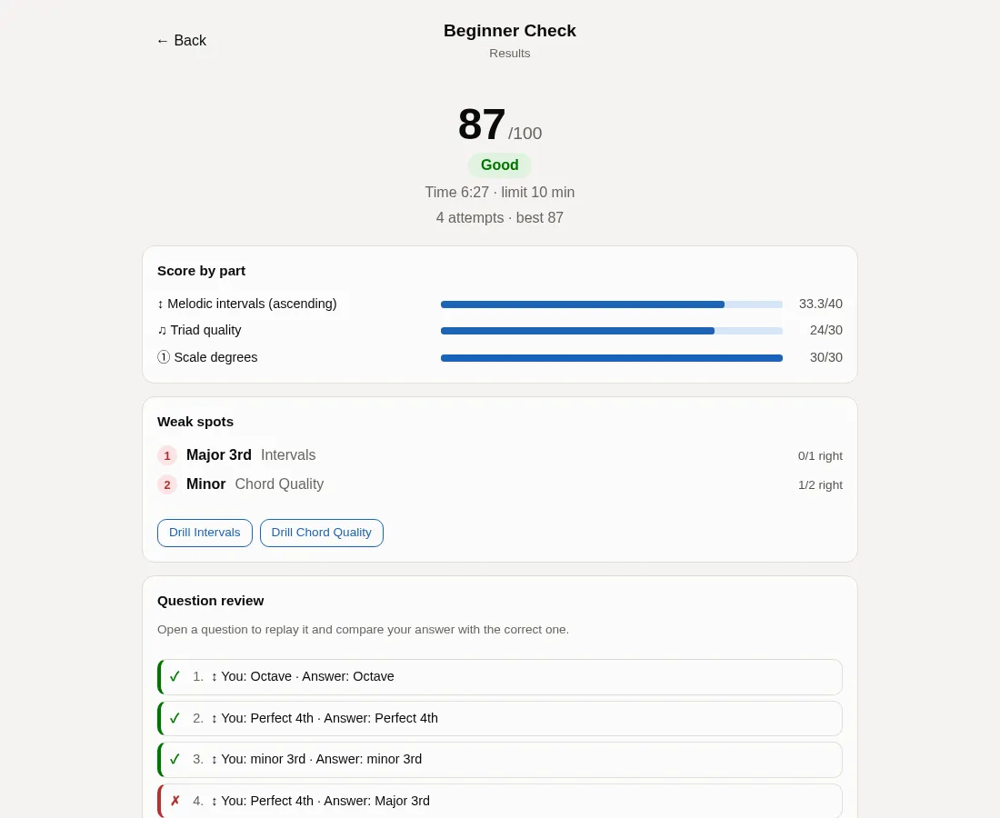</td>
  </tr>
</table>

### Sight-singing
- **Sight-singing library**: 48 graded pieces, both original drills and public-domain folk and classical melodies. Transpose them to your range, sing along with a metronome and get note-by-note pitch scoring, or practise note by note.
- **Sight-singing / echo exercise**: built-in YIN pitch detection with a live tuner. Octaves are ignored, so it works for any voice.

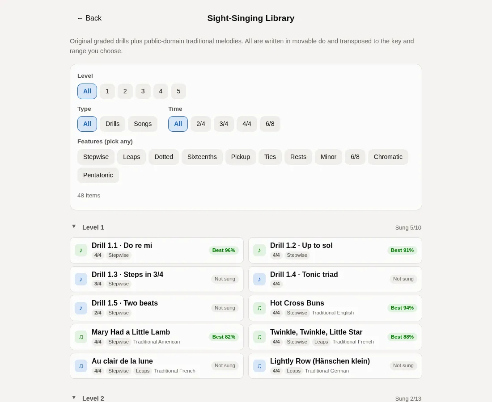

### Analytics
- **Trends**: accuracy over time (with a 7-day average), questions per day, a practice calendar heatmap and per-exercise sparklines.
- **Weak spots**: the items you most need to practise, with one-click drills.
- **Backup**: export and import a JSON backup to move your progress between devices.

### And more
- **Many instrument sounds**: synthesized piano, electric piano, sine, organ, guitar (Karplus-Strong plucked string), strings, flute and marimba, all generated in real time with Web Audio (no download, works offline, loudness-matched). Optional real samples of piano (~1.4 MB), acoustic guitar (~2.2 MB), violin (~4.4 MB) and flute (~1.8 MB) are downloaded on demand and cached for offline use; until they are ready, or outside their sampled range, the matching synthesized sound plays instead.
- **Random instrument per question**: each new question (mock exams included) picks a different instrument from piano, electric piano, organ, guitar, strings, flute, marimba and any sampled instruments you have downloaded. Replays and answer previews keep it, and the practice page shows which one is playing. You learn to recognize intervals and chords in any timbre, not just on the piano.
- **MIDI keyboard input**: play your answers in scale degrees, melodic dictation, intervals, chord inversions and the notation editor.
- **English and Chinese, light and dark**: follows your system's color scheme. New users get the language of their browser, and you can switch in Settings.
- **Keyboard shortcuts**: answer multiple-choice questions with 1–9, 0 and Q–P (up to 20 options, shown on each button), hold Shift with an answer key to audition, Space to replay, Enter for the next question. The notation editor and rhythm tapping are fully keyboard-driven too; the full list is under "About & help" in the app.
- **Accessibility**: full keyboard control, screen-reader announcements for answer feedback, WCAG AA color contrast, and 0 axe-core violations.
- **Mobile-friendly**: designed for touch, with compact narrow-screen layouts.

<p align="center">
  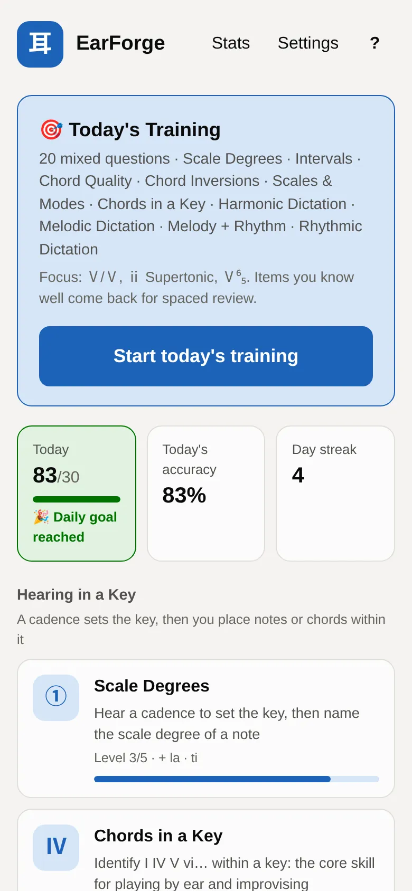
  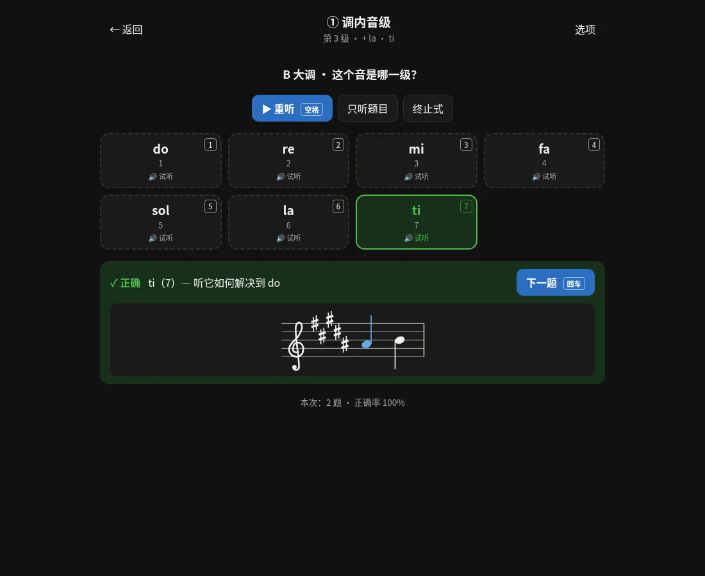
</p>

<p align="center">
  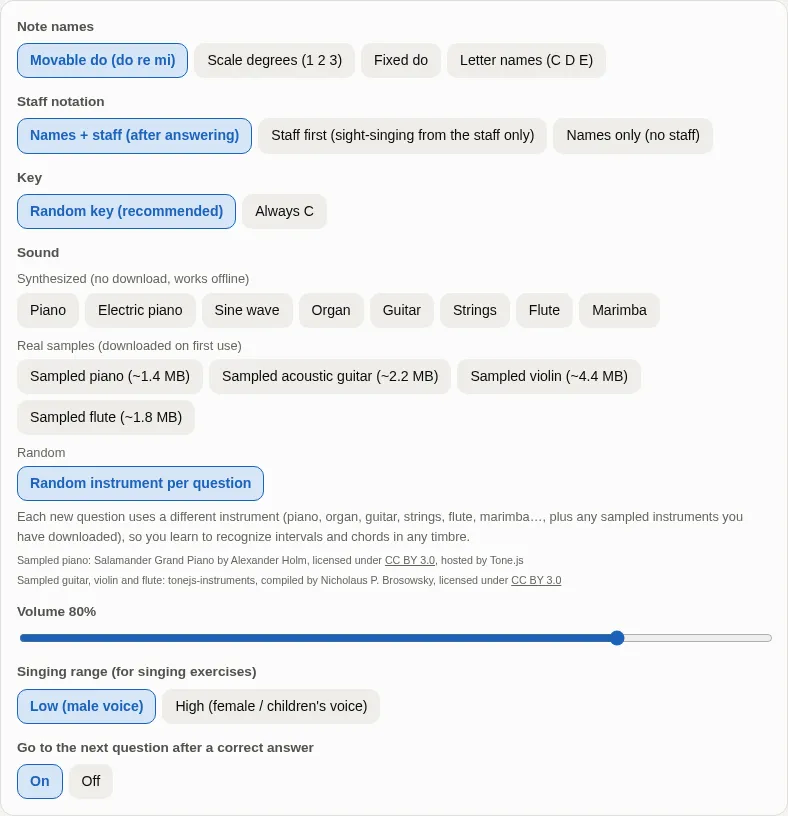
</p>

## Exercises

| Exercise | What you practise | Levels |
|---|---|---|
| Scale Degrees | Cadence + one note: name it as do re mi… (including chromatic notes), in 5 modes | 5: do mi sol → re fa → la ti → chromatic |
| Chords in a Key | Identify I IV V vi… in a key, as single chords or four-chord progressions, major and minor | 4: I IV V → vi → ii → iii vii° |
| Harmonic Dictation | Four-part progressions (4 or 6 chords): name each chord with its inversion, major and minor | 6: I IV V → vi ii → first inversions → V7 and inversions → cadential 6/4, ii7, vii°6 → secondary dominant V/V |
| Melodic Dictation | Short melodies of 3–8 notes; enter the notes in order | 4: do re mi → … → chromatic |
| Melody + Rhythm | Short melodies with rhythm; write pitches and durations in the staff editor | 9: quarters and halves → eighths → dotted → sixteenths → syncopation and ties → 6/8 → chromatic |
| Intervals | Ascending, descending or harmonic, with reference songs, including compound intervals | 12: P5 and octave → … → 9ths to 15ths |
| Chord Quality | Major, minor, diminished and augmented triads, suspended and 7th chords, with optional inversions and arpeggios | 5 |
| Chord Inversions | Hear the bass: root position, first and second inversion, and all four positions of 7th chords | 4 |
| Scales & Modes | All three forms of minor, church modes, pentatonic and blues scales, whole-tone | 7 |
| Rhythmic Dictation | Count-in + a rhythm; pick it out from similar rhythms | 5: quarters → eighths → dotted → sixteenths → syncopation and triplets |
| Rhythm Tapping | Read and tap, or listen and tap, with Space, touch or clapping; a timeline shows early, late and missed taps | 5 (same as rhythmic dictation) |
| Sight-singing / Echo | Sing from note names or after listening, judged live through the microphone | 3: do mi sol → re fa → la ti |

There is also the **sight-singing library** (48 pieces in 5 levels) and **mock exams** (3 papers).

## Quick start

### Use it

Open the **[online version](https://<your-username>.github.io/earforge/)** (TODO: replace with the real URL); there is nothing to sign up for. To use it like an app, choose "Install" or "Add to Home Screen" in your browser menu.

### Local development

Requires Node.js 22 or later.

```bash
git clone https://github.com/<your-username>/earforge.git
cd earforge
npm install
npm run dev      # dev server at http://localhost:5173
npm test         # unit tests
npm run build    # production build into dist/, deployable to any static host
npm run check    # pre-commit check: lint (warnings fail) + unit tests + build
npm run e2e      # browser end-to-end tests (puppeteer-core + local Chrome)
```

There are currently 469 unit tests (vitest, 23 files) and 17 browser end-to-end scenarios (`e2e/scenarios/`).

Stack: Vite + React + TypeScript, with no runtime dependencies besides React and no backend.

### Deploy to GitHub Pages

The repository includes [`.github/workflows/pages.yml`](.github/workflows/pages.yml):

1. Fork or push this repository to GitHub.
2. In the repository's **Settings → Pages**, set **Source** to **GitHub Actions**.
3. Push to `main` (or run "Deploy to GitHub Pages" from the Actions tab). The workflow runs the unit tests, builds with `BASE_PATH=/<repo-name>/` and publishes to `https://<your-username>.github.io/<repo-name>/`.
4. If you use a custom domain (site at the root path), add a repository variable `PAGES_BASE_PATH` with the value `/` under **Settings → Secrets and variables → Actions → Variables**.

For other static hosts, run `npm run build` to deploy at the root, or `BASE_PATH=/earforge/ npm run build` for a subpath. The manifest, service worker and precache list use relative paths, so offline mode works under a subpath too.

## Privacy

- No accounts, no server, no analytics and no third-party scripts.
- Progress and settings are stored only in your browser's localStorage. You can export or import a backup in Settings. Clearing your browser data also clears your progress.
- Microphone audio is analysed for pitch on your device in real time. It is never recorded or uploaded.
- The only network requests are the optional sampled instruments: the sampled piano is downloaded once from the public Tone.js host, and the sampled guitar / violin / flute from the tonejs-instruments GitHub Pages site. The synthesized sounds need no network.

## Browser support

- Use a current version of Chrome, Edge, Firefox or Safari, on desktop or mobile.
- The **microphone** (sight-singing, sing-along, clap input for rhythm tapping) needs the page to be served over **HTTPS** or from `localhost`, and microphone permission.
- **MIDI keyboards** need a browser with Web MIDI: Chrome, Edge and Firefox work. Safari and all browsers on iOS do not support it.
- **iPhone / iPad**: turn off the silent switch on the side, or web pages make no sound. In Safari, "Share → Add to Home Screen" installs EarForge for offline use.

## Roadmap

Done (see [CHANGELOG.md](CHANGELOG.md)):

- [x] Scale degrees, chords in a key, melodic dictation, intervals, chord quality, sight-singing / echo (0.1)
- [x] Minor keys and modes, rhythmic dictation, Today's Training, weak-spot drills, daily goal (0.2)
- [x] Sampled piano, compare-when-wrong, MIDI keyboard input, rhythm tapping (0.3)
- [x] Staff notation, guided start, English interface (0.4)
- [x] Rhythmic staff notation, sight-singing library, trend charts (0.5)
- [x] Melody + rhythm dictation, mock exams, lazy loading and accessibility (0.6)
- [x] Scales and modes, chord inversions, compound intervals, in-repo e2e and CI, GitHub Pages deployment, in-app help (0.7)
- [x] Harmonic dictation (four-part, also in mock exams), more instruments and a random instrument per question, 20 answer keys (0.8)

Ideas for next steps (discussion welcome in Issues):

- [ ] More harmonic dictation: two voices, bass lines, more chromatic chords
- [ ] More public-domain sight-singing pieces
- [ ] Custom exercise sets and shareable practice links

## Contributing

Issues and pull requests are welcome! Please read [CONTRIBUTING.md](CONTRIBUTING.md) first. It covers the architecture, adding exercises and songs, tests and commit style.

The song library only accepts EarForge originals and **public-domain** melodies (traditional tunes, or works whose composer died more than 70 years ago). Transcribe the original melody yourself, and state the source and why it is in the public domain in your PR.

The README screenshots are generated by `scripts/screenshots.mjs` (`npm run build && node scripts/screenshots.mjs`, one set each in Chinese and English; `--only harmony,settings` shoots a subset and `--url` uses a running site).

## License and credits

- Code is released under the [MIT license](LICENSE).
- The sampled piano uses [Salamander Grand Piano](https://archive.org/details/SalamanderGrandPianoV3) by Alexander Holm, licensed under [CC BY 3.0](https://creativecommons.org/licenses/by/3.0/) and hosted by [Tone.js](https://github.com/Tonejs/Tone.js). It is downloaded on demand at runtime and is not distributed with this repository.
- The sampled acoustic guitar, violin and flute come from [tonejs-instruments](https://github.com/nbrosowsky/tonejs-instruments) (compiled by Nicholaus P. Brosowsky; samples licensed under [CC BY 3.0](https://creativecommons.org/licenses/by/3.0/)), hosted on its GitHub Pages site. They are downloaded on demand at runtime and are not distributed with this repository.
- Songs in the sight-singing library are public-domain melodies (traditional tunes, or works whose composer died more than 70 years ago); the drills are EarForge originals.
