# EarForge 耳锻

[English](README.en.md) | 中文

**在音乐里听出音来：开源、免费、离线可用的首调练耳训练，打开浏览器就能练。**

<!-- TODO: 部署 GitHub Pages 后把下面的链接换成你的地址 -->
**[▶ 在线试用](https://<your-username>.github.io/earforge/)**（TODO：替换为实际地址）· [更新日志](CHANGELOG.md) · [参与贡献](CONTRIBUTING.md)

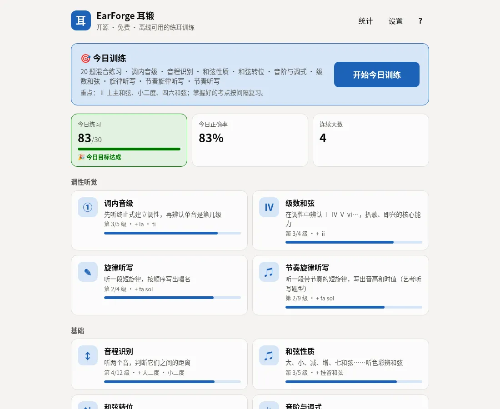

<table>
  <tr>
    <td width="50%">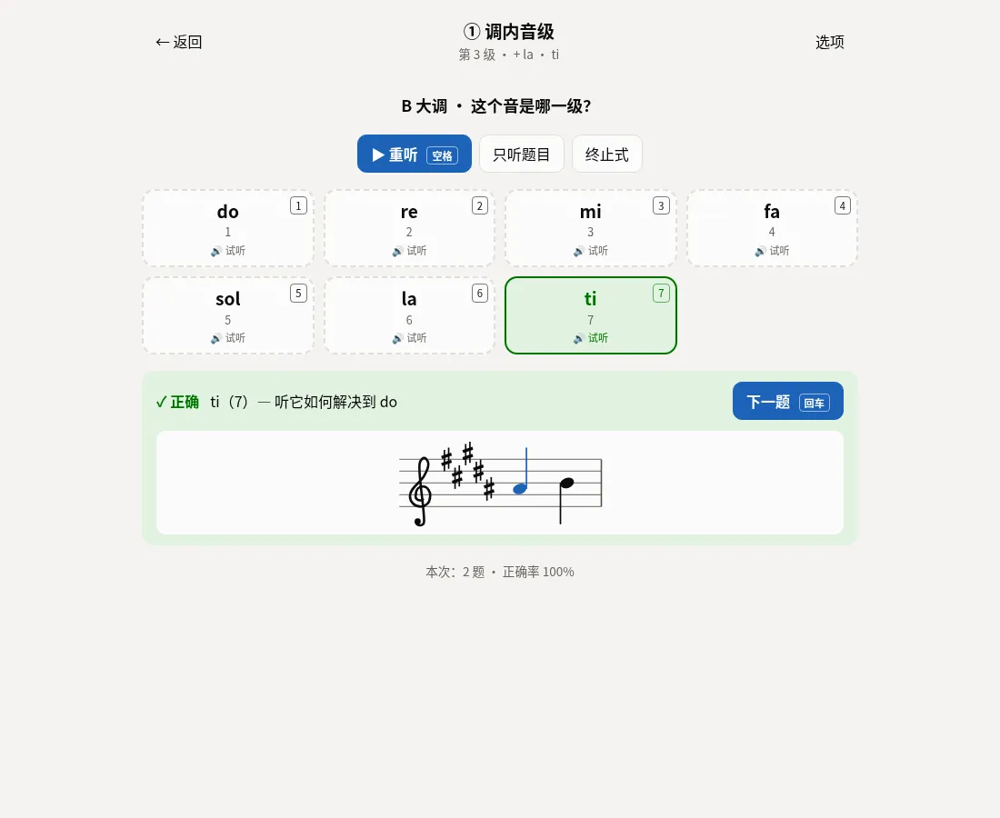</td>
    <td width="50%">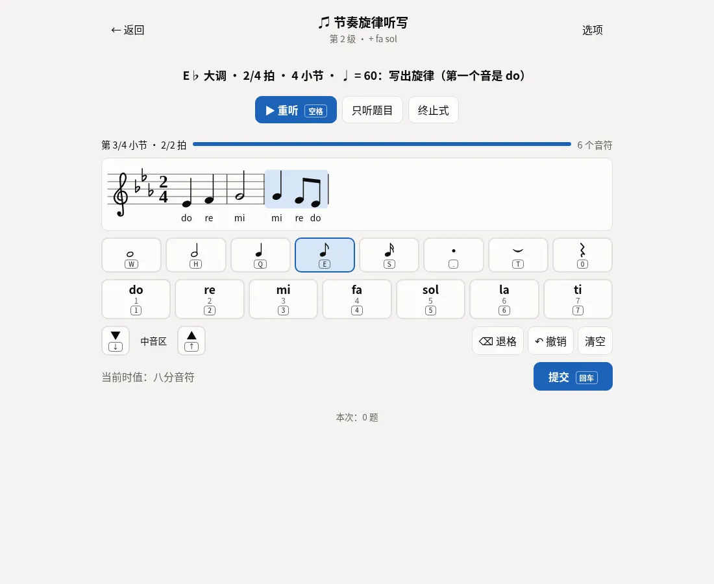</td>
  </tr>
  <tr>
    <td>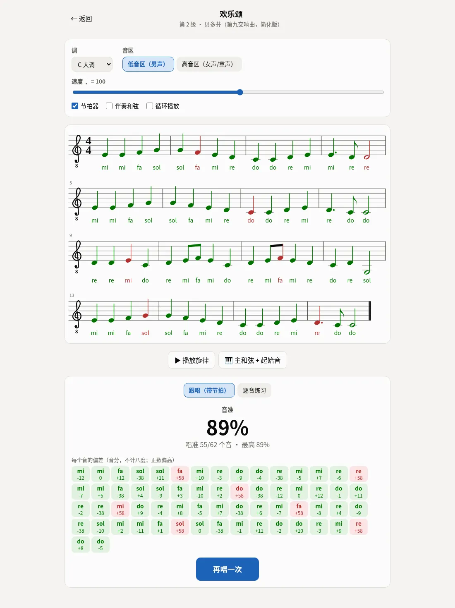</td>
    <td>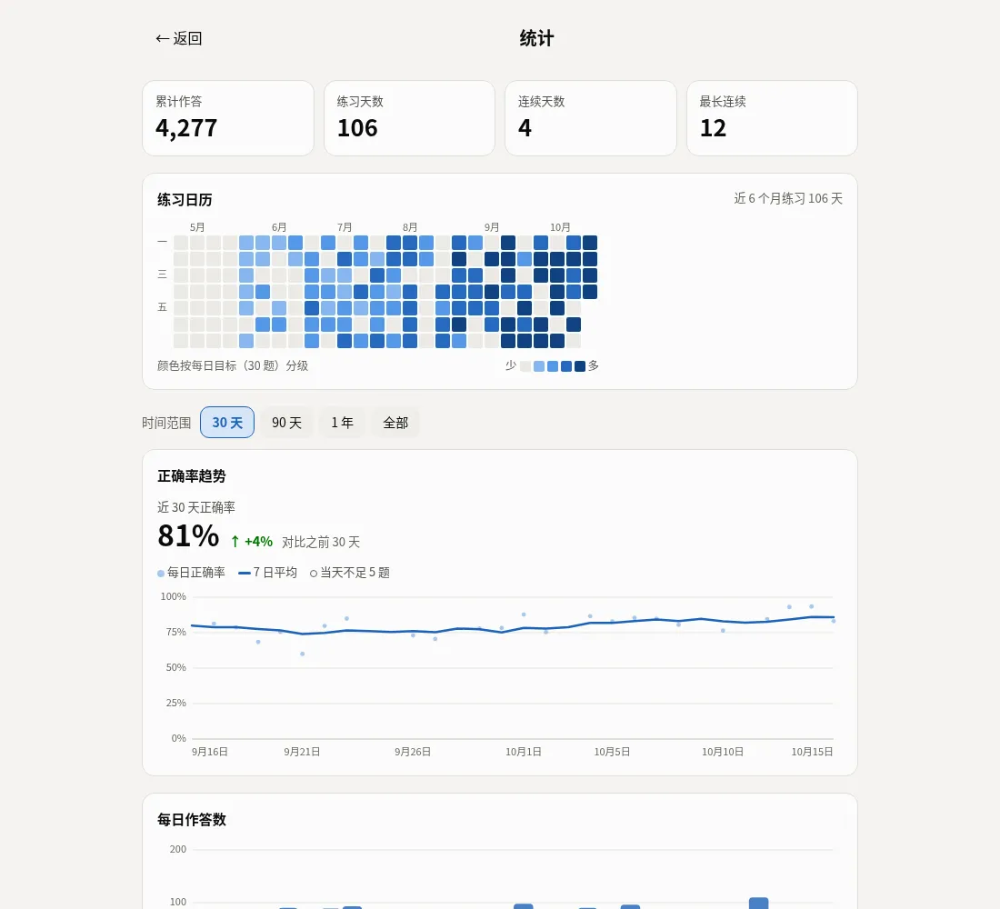</td>
  </tr>
</table>

## 为什么是耳锻

- **功能性练耳**：每道题先用终止式建立调性，再让你辨认音、和弦在调里的「功能」，答完播放它解决到 do 的路径。练的是在真实音乐里听出音，而不只是孤立的音程。
- **首调唱名（可移动的 do）**：do 永远是主音，换调不换唱名，这正是扒歌、视唱和即兴时用到的相对音感。也可以切换成简谱、固定调唱名或字母音名。
- **自适应、有计划**：按间隔重复安排「今日训练」，不熟的考点多出，掌握后自动升级；统计页一键专练薄弱点。
- **免费、开源、无需注册**：MIT 许可，没有账号、没有广告、没有统计追踪，数据只存在你的浏览器里。
- **离线可用**：PWA，可安装到桌面或手机主屏幕；首次打开后断网也能练。

和常见的付费练耳软件（如 EarMaster、Tenuto）相比：那些软件有成熟的课程体系、更多题型和面向老师与学校的功能，值得了解。耳锻的定位不同，它是一个免费、开源的 Web 应用，打开网页即可使用，不需要安装或注册，中文界面优先，围绕首调与调性听觉设计。

| | 耳锻 | 常见付费练耳软件 |
|---|---|---|
| 价格 | 免费 | 一次性购买或订阅 |
| 账号 | 不需要 | 视产品而定 |
| 平台 | 任意现代浏览器（桌面 / 手机），可安装为 PWA | 桌面或应用商店的 App |
| 离线 | 支持 | 视产品而定 |
| 源代码 | 开源（MIT） | 不公开 |
| 数据 | 只保存在本机浏览器，可导出 | 视产品而定，部分产品同步到云端 |

## 功能

### 每天练一点
- **今日训练**：一键开始。按间隔重复从各模块挑出最需要练的考点，混合成一组（默认 20 题），练完给出小结。
- **自适应出题**：记录每个考点的掌握度，不熟的多出、久未练的复习；当前级别全部掌握后自动解锁下一级。
- **答错就对比**：答错时自动播放你选的答案；答完后每个选项都能试听，「你的答案 / 正确答案」一键对比。
- **每日目标与连续天数**，首页一目了然。
- **新手引导**：首次打开按你的基础（零基础 / 学过乐器 / 备考）设定起点，每个练习首次进入有玩法提示。

### 备考
- **模拟考试**：入门测验、考级模拟、艺考模拟三套试卷。作答时没有反馈，可限时、限重听；交卷后给出成绩单、各部分得分、薄弱考点与逐题回顾（可重听对比），保留历史成绩。
- **自定义练习组合与分享链接**：把几个练习的考点、选项和出题比重搭成一组混合练习（有 5 个模板可直接用），保存在本地。一键生成分享链接，对方打开就能开始或保存；打开「固定题目」后，每个打开同一链接的人拿到完全相同的一组题，适合老师给全班布置作业。链接内容只在网址 `#` 之后，不经过服务器。
- **节奏旋律听写**：艺考题型，在五线谱编辑器里用键盘、按钮或 MIDI 键盘写出音高和时值，音高与节奏分开判分。
- **和声听写**：听四部和声进行（4 或 6 个和弦），逐个写出级数与转位；从 Ⅰ Ⅳ Ⅴ 一路到六和弦、属七及其转位、终止四六、ⅱ⁷、ⅶ°⁶ 与副属和弦 Ⅴ/Ⅴ，大小调都有。进行按功能和声文法生成，声部就近进行、没有平行五八度；选项按主 / 下属 / 属 / 副属功能分组，答完附大谱表。考级与艺考模拟试卷也包含这一部分。
- **五线谱**：正确拼写调号与升降号，带时值记谱（拍号、符杠、附点、连音线、三连音、自动换行）。

<table>
  <tr>
    <td width="50%">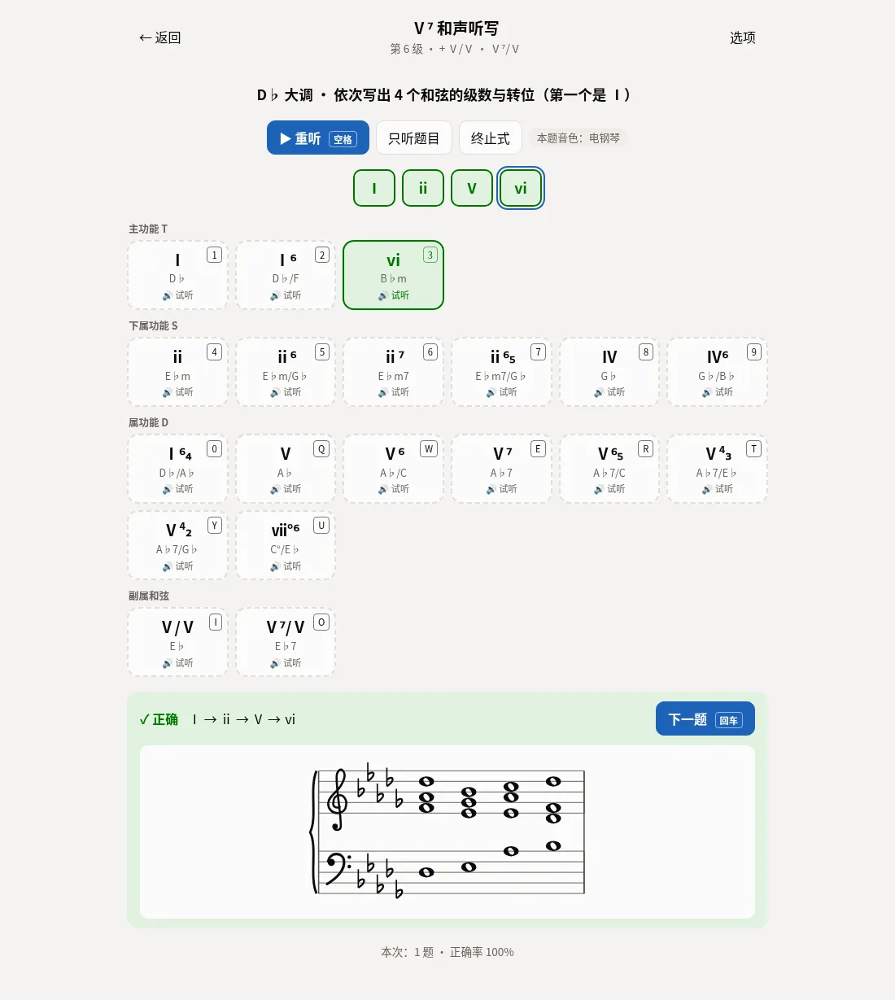</td>
    <td width="50%">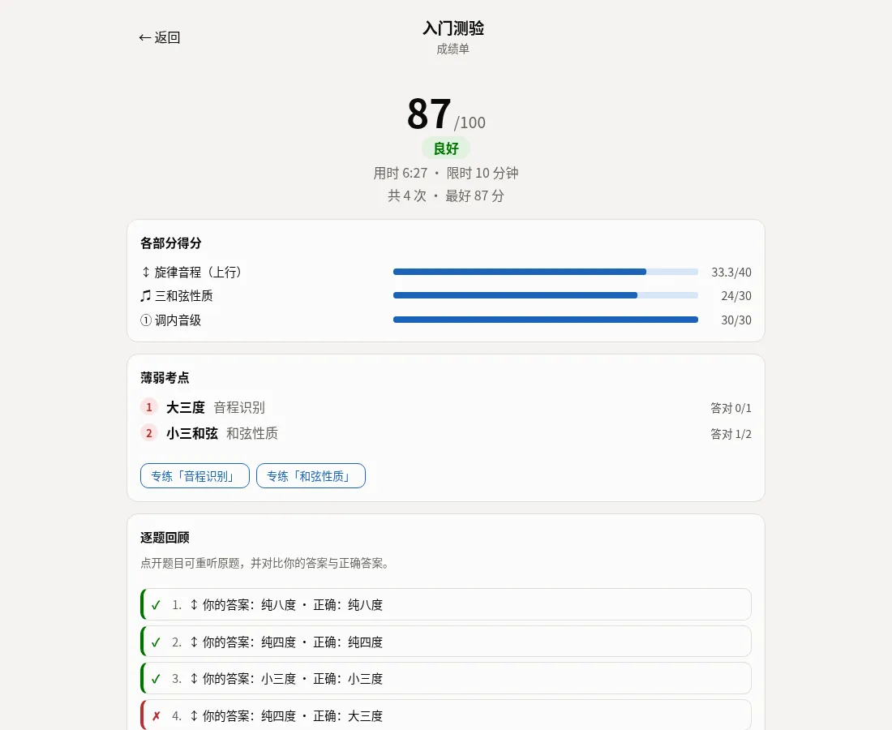</td>
  </tr>
</table>

### 给老师：布置作业、收成绩
- **成绩链接**：学生练完固定题目的组合后，在小结的「分享成绩」里填上名字，点「生成并复制成绩链接」，就得到一条成绩链接（20 题的作业约 220–350 字符），用聊天软件发给老师即可。链接里带每题对错、得分、完成时间与用时，带校验，被截断或改动时打不开；不含设备或账号信息。
- **成绩页**：老师打开链接即可看到得分、每题对错与考点（由组合的 seed 重新推出，与学生实际做的题一致）和各练习表现。只是查看，不计入老师自己的练习记录。
- **成绩单**：在成绩页点「添加到成绩单」，成绩按作业汇总成一张学生 × 得分表，可排序，可导出 CSV（含每题对错，Excel 直接打开）。成绩单保存在老师的浏览器里，随备份导出 / 导入。
- 全程在浏览器里完成：没有服务器、不用注册，学生和老师都不需要账号。

<table>
  <tr>
    <td width="50%">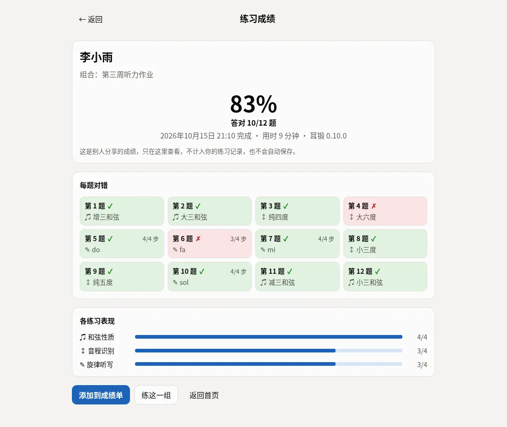</td>
    <td width="50%">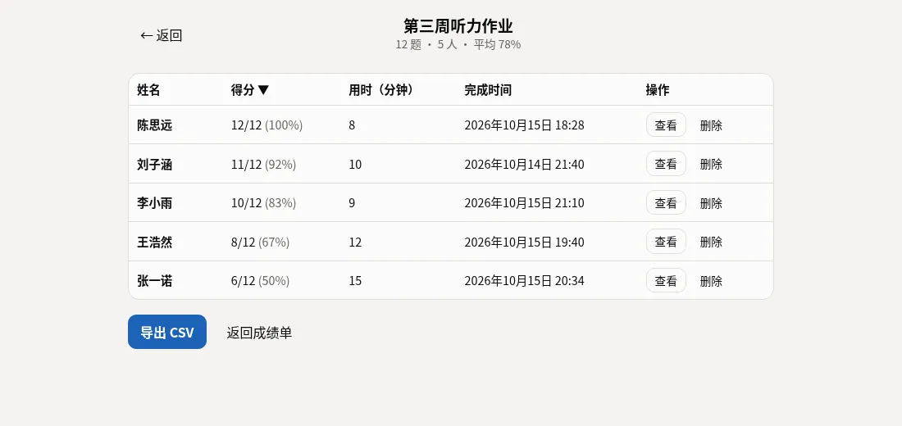</td>
  </tr>
</table>

### 视唱
- **视唱曲库**：48 首从易到难的曲目，包括原创分级练习和公有领域的民歌与古典旋律。可移调到你的音区，跟节拍器演唱，逐音评分；也可以逐音练习。
- **视唱 / 模唱练习**：内置 YIN 音高检测，对着麦克风唱，实时显示音准偏差（不计八度，男女声都适用）。

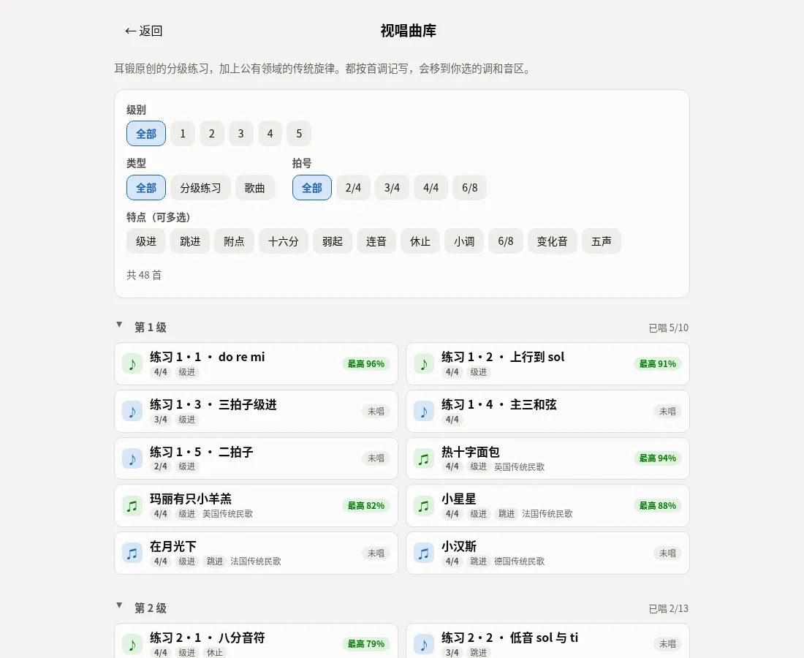

### 数据与分析
- **趋势图**：正确率走势（含 7 日平均）、每日题量、练习日历热力图、各模块小图。
- **薄弱点**：按掌握度列出最需要练的考点，一键专练。
- **备份**：导出 / 导入 JSON 备份，换设备也不丢进度。

### 其他
- **多种乐器音色**：合成的钢琴、电钢琴、纯音、风琴、吉他（Karplus-Strong 拨弦）、弦乐、长笛、马林巴，全部 Web Audio 实时合成（零下载、离线可用，响度已互相平衡）；可选真实采样的钢琴（约 1.4 MB）、木吉他（约 2.2 MB）、小提琴（约 4.4 MB）、长笛（约 1.8 MB），按需下载后离线可用，未下载完或超出采样音域时自动换成同类合成音色。
- **每题随机换乐器**：每道新题（含模拟考试）从钢琴、电钢琴、风琴、吉他、弦乐、长笛、马林巴和已下载的采样乐器里随机换一种，本题重听与选项试听沿用，练习页显示本题音色。练的是在不同音色下识别音程与和弦，不只听得出钢琴。
- **MIDI 键盘作答**：调内音级、旋律听写、音程、和弦转位与记谱编辑器都支持直接弹出答案。
- **中英双语、浅色 / 深色**：跟随系统明暗；新用户按浏览器语言显示，设置里可切换。
- **键盘快捷键**：选择题用 1–9、0、Q–P 作答（最多 20 个选项，按钮右上角标出），Shift + 作答键试听，空格重听，回车下一题；记谱编辑器与节奏模仿也能全键盘操作，完整列表见应用内「关于与帮助」。
- **无障碍**：完整的键盘操作、读屏播报答题反馈、颜色对比度达到 WCAG AA，axe-core 审计 0 违规。
- **手机友好**：按触屏设计，窄屏布局紧凑，点按区域不小于 44px，触屏上不显示快捷键提示。
- **打开快**：首屏 JS 约 122 KB（gzip），练习页、考试等按需加载并在后台预取；构建后由体积预算脚本检查，超出即失败。

<p align="center">
  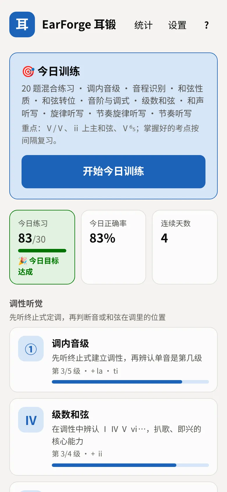
  
</p>

<p align="center">
  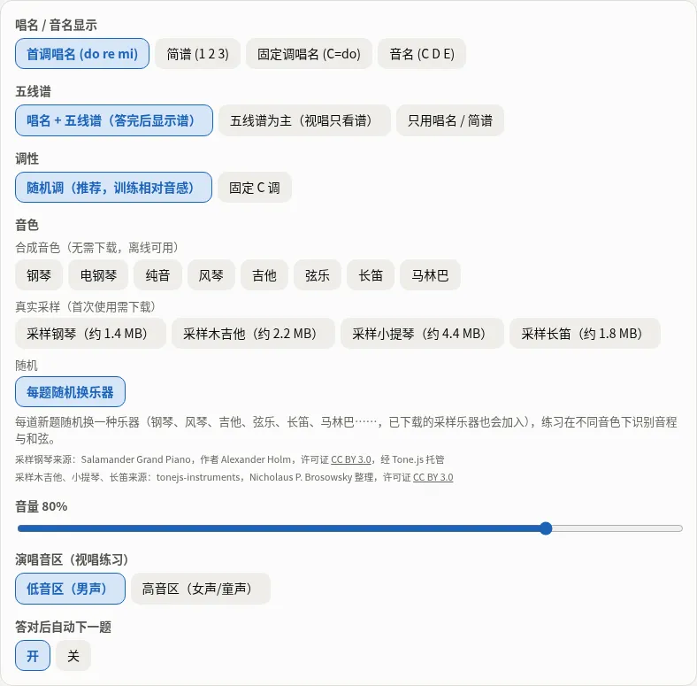
</p>

## 练习模块

| 模块 | 练什么 | 级别 |
|---|---|---|
| 调内音级 | 终止式 + 单音，辨认 do re mi…（含变化音），支持 5 种调式 | 5 级：do mi sol → re fa → la ti → 变化音 |
| 级数和弦 | 在调中辨认 Ⅰ Ⅳ Ⅴ ⅵ…，单个和弦或四和弦进行，大小调都有 | 4 级：Ⅰ Ⅳ Ⅴ → ⅵ → ⅱ → ⅲ ⅶ° |
| 和声听写 | 四部和声进行（4 或 6 个和弦），逐个写出级数与转位，大小调都有 | 6 级：Ⅰ Ⅳ Ⅴ → ⅵ ⅱ → 六和弦 → 属七及其转位 → 终止四六、ⅱ⁷、ⅶ°⁶ → 副属 Ⅴ/Ⅴ |
| 旋律听写 | 3–8 个音的短旋律，按顺序写出唱名 | 4 级：do re mi → … → 变化音 |
| 节奏旋律听写 | 带节奏的短旋律，在五线谱编辑器里写出音高和时值 | 9 级：四分二分 → 八分 → 附点 → 十六分 → 切分连音线 → 6/8 → 变化音 |
| 音程识别 | 上行 / 下行 / 和声音程，附歌曲记忆法，含复音程 | 12 级：纯五度八度 → … → 九度至十五度 |
| 和弦性质 | 大小减增三和弦、挂留和弦、七和弦，可选转位与琶音 | 5 级 |
| 和弦转位 | 听低音：原位、六和弦、四六和弦，七和弦的四种位置 | 4 级 |
| 音阶与调式 | 大小调三种形式、教会调式、五声与布鲁斯音阶、全音阶 | 7 级 |
| 节奏听写 | 预备拍 + 节奏型，从相似的节奏谱中选出听到的那个 | 5 级：四分 → 八分 → 附点 → 十六分 → 切分三连音 |
| 节奏模仿 | 看谱或听后打出节奏（空格 / 触屏 / 拍手），时间轴显示偏早、偏晚与漏打 | 5 级（同节奏听写） |
| 视唱 / 模唱 | 看唱名唱或听后唱，麦克风实时判定 | 3 级：do mi sol → re fa → la ti |

另有 **视唱曲库**（48 首，5 个难度）与 **模拟考试**（3 套试卷）。

## 快速开始

### 直接使用

打开 **[在线版](https://<your-username>.github.io/earforge/)**（TODO：替换为实际地址），不需要注册。想像 App 一样使用，可以在浏览器菜单里选择「安装」或「添加到主屏幕」。

### 本地开发

需要 Node.js 22 及以上。

```bash
git clone https://github.com/<your-username>/earforge.git
cd earforge
npm install
npm run dev      # 开发服务器 http://localhost:5173
npm test         # 单元测试
npm run build    # 生产构建，输出 dist/，可部署到任意静态托管
npm run check    # 提交前检查：lint（警告也算失败）+ 单元测试 + 构建 + 首屏体积预算
npm run e2e      # 浏览器端到端测试（puppeteer-core + 本机 Chrome）
```

目前有 567 个单元测试（vitest，30 个文件）和 21 个浏览器端到端场景（`e2e/scenarios/`）。

技术栈：Vite + React + TypeScript，除 React 外没有运行时依赖，没有后端。

### 部署到 GitHub Pages

仓库已经带有 [`.github/workflows/pages.yml`](.github/workflows/pages.yml)：

1. Fork 或推送本仓库到 GitHub。
2. 在仓库的 **Settings → Pages** 里，把 **Source** 设为 **GitHub Actions**。
3. 推送到 `main` 分支（或在 Actions 页手动运行「Deploy to GitHub Pages」）。工作流会跑单元测试，然后以 `BASE_PATH=/<仓库名>/` 构建并发布到 `https://<你的用户名>.github.io/<仓库名>/`。
4. 如果绑定了自定义域名（站点在根路径），在 **Settings → Secrets and variables → Actions → Variables** 里添加仓库变量 `PAGES_BASE_PATH`，值为 `/`。

部署到其他静态托管时，在根路径部署直接 `npm run build`；部署到子路径时用 `BASE_PATH=/earforge/ npm run build`。manifest、service worker 与预缓存清单都按相对路径生成，子路径下同样可以离线使用。

## 隐私

- 没有账号、没有服务器、没有统计追踪或第三方脚本。
- 练习记录与设置只保存在浏览器的 localStorage 里，可在设置页导出或导入备份；清除浏览器数据会一并清除记录。
- 成绩链接只包含成绩与学生自己填的名字（可不填），由学生自己发送；老师的成绩单只保存在老师的浏览器里。
- 麦克风的声音只在本机实时分析音高，不录音，也不上传。
- 唯一的网络请求是可选的采样乐器：选择采样钢琴时从 Tone.js 的公开托管地址、选择采样木吉他 / 小提琴 / 长笛时从 tonejs-instruments 的 GitHub Pages 下载一次音频文件。合成音色无需联网。

## 浏览器支持

- 推荐使用最新版的 Chrome、Edge、Firefox 或 Safari（桌面与手机）。
- **麦克风**（视唱、跟唱、拍手打节奏）需要通过 **HTTPS** 或 `localhost` 打开页面，并授予麦克风权限。
- **MIDI 键盘**需要支持 Web MIDI 的浏览器：Chrome、Edge、Firefox 可以；Safari 和 iOS 上的所有浏览器都不支持。
- **iPhone / iPad**：请关闭侧面的静音开关，否则网页没有声音；在 Safari 中「分享 → 添加到主屏幕」可以像 App 一样离线使用。

## 路线图

已完成（详见 [CHANGELOG.md](CHANGELOG.md)）：

- [x] 调内音级、级数和弦、旋律听写、音程、和弦性质、视唱 / 模唱（0.1）
- [x] 小调与调式、节奏听写、今日训练、薄弱点专练、每日目标（0.2）
- [x] 采样钢琴、答错对比试听、MIDI 键盘作答、节奏模仿（0.3）
- [x] 五线谱、新手引导、英文界面（0.4）
- [x] 带时值的五线谱、视唱曲库、趋势图（0.5）
- [x] 节奏旋律听写、模拟考试、按需加载与无障碍（0.6）
- [x] 音阶与调式、和弦转位、复音程、仓库内 e2e 与 CI、GitHub Pages 部署、应用内帮助（0.7）
- [x] 和声听写（四部和声，进入模拟考试）、更多乐器音色与每题随机换乐器、20 个作答键（0.8）
- [x] 自定义练习组合、分享链接与固定题目（0.9）
- [x] 成绩链接与成绩单（老师收作业）、组合编辑页手机适配、首屏性能与体积预算（0.10）

接下来的想法（欢迎在 Issue 里讨论）：

- [ ] 和声听写扩展：两声部、低音线条、更多变化和弦
- [ ] 更多公有领域视唱曲目

## 参与贡献

欢迎 Issue 与 PR！请先阅读 [CONTRIBUTING.md](CONTRIBUTING.md)，其中有架构说明、如何新增练习与曲目、测试与提交规范。

曲库只接受耳锻原创练习和**公有领域**旋律（传统民歌，或作者去世超过 70 年的作品），请自己根据原始旋律记写，并在 PR 里写明来源与判断依据。

README 里的截图由 `scripts/screenshots.mjs` 生成（`npm run build && node scripts/screenshots.mjs`，中英文各一套；`--only harmony,settings` 只截部分，`--url` 使用已运行的站点）。

## 许可与致谢

- 代码以 [MIT 许可](LICENSE) 发布。
- 采样钢琴音色使用 [Salamander Grand Piano](https://archive.org/details/SalamanderGrandPianoV3)，作者 Alexander Holm，许可 [CC BY 3.0](https://creativecommons.org/licenses/by/3.0/)，由 [Tone.js](https://github.com/Tonejs/Tone.js) 托管。运行时按需下载，不随仓库分发。
- 采样木吉他、小提琴、长笛来自 [tonejs-instruments](https://github.com/nbrosowsky/tonejs-instruments)（Nicholaus P. Brosowsky 整理），采样许可 [CC BY 3.0](https://creativecommons.org/licenses/by/3.0/)，由其 GitHub Pages 托管。运行时按需下载，不随仓库分发。
- 视唱曲库中的歌曲均为公有领域旋律（传统民歌，或作者去世超过 70 年的作品），练习曲为耳锻原创。
